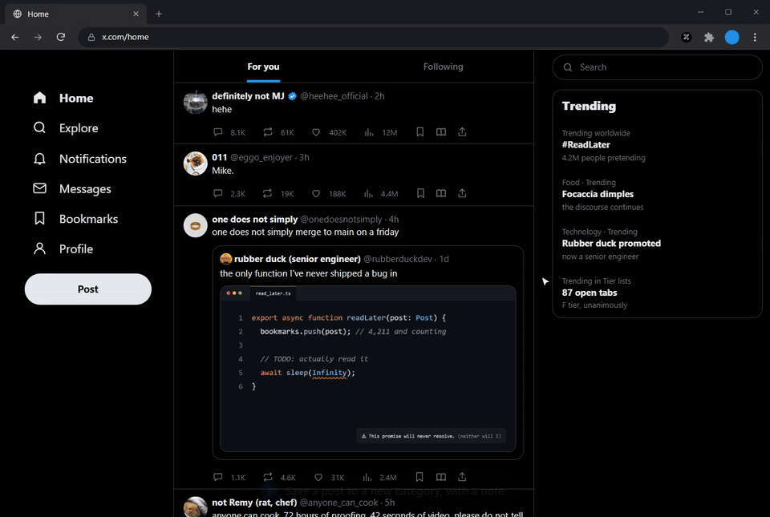

<p align="center">
  
</p>

<h1 align="center">XMarks</h1>

<p align="center">
  <strong>Save it on X. Find it in XMarks.</strong><br>
  Search, sort and add notes to your X (Twitter) bookmarks.<br>
  Free, no account, and everything stays in your browser.
</p>

<p align="center">
  <a href="LICENSE"></a>
  
  
</p>

<p align="center">
  <a href="https://yarooqh.github.io/xmarks/">Website</a> ·
  <a href="#install">Install</a> ·
  <a href="https://yarooqh.github.io/xmarks/privacy/">Privacy policy</a> ·
  <a href="https://github.com/YarooqH/xmarks/issues">Report a bug</a>
</p>

<p align="center">
  
</p>

X bookmarks are one long list. Folders need a paid subscription, search only matches post text, and there are no tags, notes or backups. XMarks adds a save button to X and keeps a copy of everything you bookmark in a library you can search, sort and annotate.

## How it works

### 1. Save posts as you scroll

A book button sits in every post's action bar. Click it, pick a category and add a note. If you'd rather keep using X's own bookmark button, switch to **Override Native** and XMarks saves a copy whenever you use it.


### 2. Find it later

Click the XMarks icon in Chrome's toolbar for your latest saves, or open the dashboard to search post text, quoted posts, authors, tags and your notes.


### 3. Bring in the bookmarks you already have

Open your Bookmarks on X and click **Sync Bookmarks** under the Post button. XMarks scrolls through the list and keeps a copy of every post, skipping ones it already has. You can pause and pick up later.


## Features

- **Categories, tags and notes.** Color-coded categories, free-form tags and a private note on any post.
- **Bulk actions.** Tick posts, or select everything in view, then move, export or delete them in one go.
- **Posts that outlast X.** Saved text stays readable if the author deletes the post, goes private or gets suspended. Images load from X, so those can disappear.
- **One library per X account, if you want it.** Everything goes into one library by default. From the library menu in the sidebar you can add libraries, pick where new saves go, or choose "One library per X account" so each account gets its own.
- **Optional auto-categorize.** A small embedding model (`all-MiniLM-L6-v2`, about 45 MB) sorts posts into your categories. It downloads once from Hugging Face when you switch it on and then runs in your browser. It's off by default.
- **Export and import.** Save your whole library, or just the selected posts, to a JSON file with categories, tags and notes, and import it in another browser.
- **Fits in with X.** The save button and menus follow X's Light, Dim and Dark themes. The dashboard has light, dark and system themes, four card densities and your choice of accent color.


### Keyboard shortcuts

| Key | Action |
| --- | --- |
| <kbd>/</kbd> | Search |
| <kbd>E</kbd> | Edit the note on the post under your pointer |
| <kbd>C</kbd> | New category |
| <kbd>G</kbd> then <kbd>A</kbd> | Go to All Bookmarks |
| <kbd>?</kbd> | Show all shortcuts |

## Privacy

- Your library lives in your browser's IndexedDB. There is no XMarks account, server or analytics.
- The extension asks for `storage` and `unlimitedStorage`, and runs only on `x.com` and `twitter.com`.
- Images and avatars in the dashboard load from X, like they do on X itself.
- The only other download is the auto-categorize model, and only if you turn that feature on.

All libraries share one browser profile, so anyone who can open that profile can open them. Use separate Chrome profiles to keep people apart. The full details are in the [privacy policy](https://yarooqh.github.io/xmarks/privacy/).

## Install

Install XMarks from the [Chrome Web Store](https://chromewebstore.google.com/detail/hhdfgcjebkpakbcjaiikoceimfeogpih). It works in Chrome, Edge, Brave and other Chromium browsers.

### From source

You'll need [Node.js](https://nodejs.org/) 20.19+ or 22.12+.

```bash
git clone https://github.com/YarooqH/xmarks.git
cd xmarks
npm install
npm run build
```

Then load it:

1. Open `chrome://extensions`.
2. Turn on **Developer mode** (top right).
3. Click **Load unpacked** and choose the `dist` folder.
4. Open [x.com/i/bookmarks](https://x.com/i/bookmarks) and click **Sync Bookmarks**.

## Development

```bash
npm run dev     # build with hot reload into dist/
npm test        # unit tests (Vitest)
npm run lint    # oxlint
```

| Path | What's there |
| --- | --- |
| `src/content/` | Content script on X: save button, popover, Sync Bookmarks |
| `src/dashboard/` | The full-page library (React) |
| `src/background.ts` | Service worker: saves, imports, opening the dashboard |
| `src/db/` | IndexedDB schema (Dexie) |
| `landing/` | The website (Astro), deployed to GitHub Pages |
| `store-assets/` | Scripts that capture the screenshots and the demo GIF |

Built with React, TypeScript, Vite, Dexie and Transformers.js on Manifest V3.

The screenshots and GIF in this README come from the real extension running against a fictional X timeline, with no network or X account. To regenerate them after a UI change (needs Microsoft Edge, and ffmpeg for the GIF):

```bash
npm run build
cd store-assets
npm install
npm run capture   # screenshots -> store-assets/output/
npm run demo      # demo GIF -> store-assets/output/demo/
```

Then copy the ones you want into `docs/images/`.

## Contributing

Bug reports and pull requests are welcome. For anything bigger than a small fix, please open an issue first so we can agree on the approach. [CONTRIBUTING.md](CONTRIBUTING.md) covers setup, tests and commit style, and everyone taking part follows the [code of conduct](CODE_OF_CONDUCT.md).

Found a security problem? Please report it privately, as described in [SECURITY.md](SECURITY.md).

## License

[MIT](LICENSE)

XMarks is not affiliated with X Corp.
